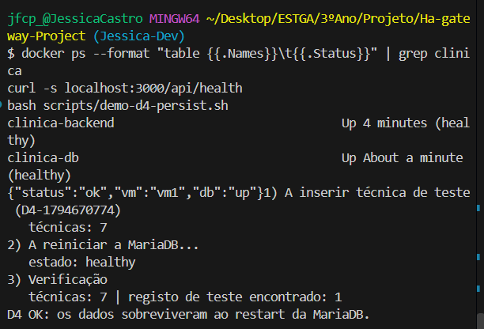

## D4: Persistência dos dados (RNF-04)

**Objetivo:** provar que os dados guardados na base de dados sobrevivem ao reinício do contentor.

**Comando:**

```bash
bash scripts/demo-d4-persist.sh
```

**O que o script faz:**
1. Insere um registo (uma técnica de teste) através da API.
2. Reinicia o contentor da MariaDB e espera que fique `healthy`.
3. Confirma que o registo continua na base de dados.

**Resultado esperado:** o script termina com `D4 OK: os dados sobreviveram ao restart da MariaDB.`

