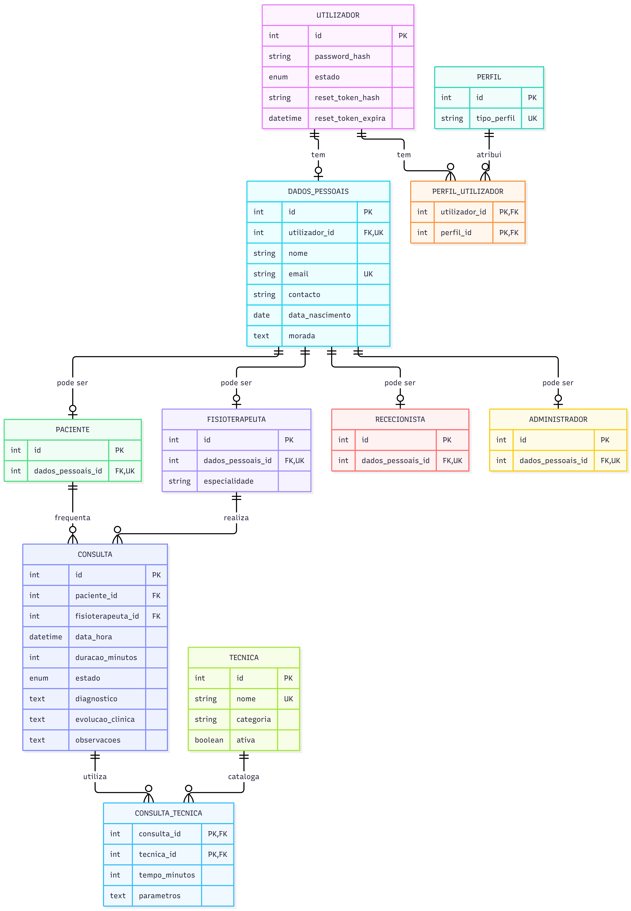
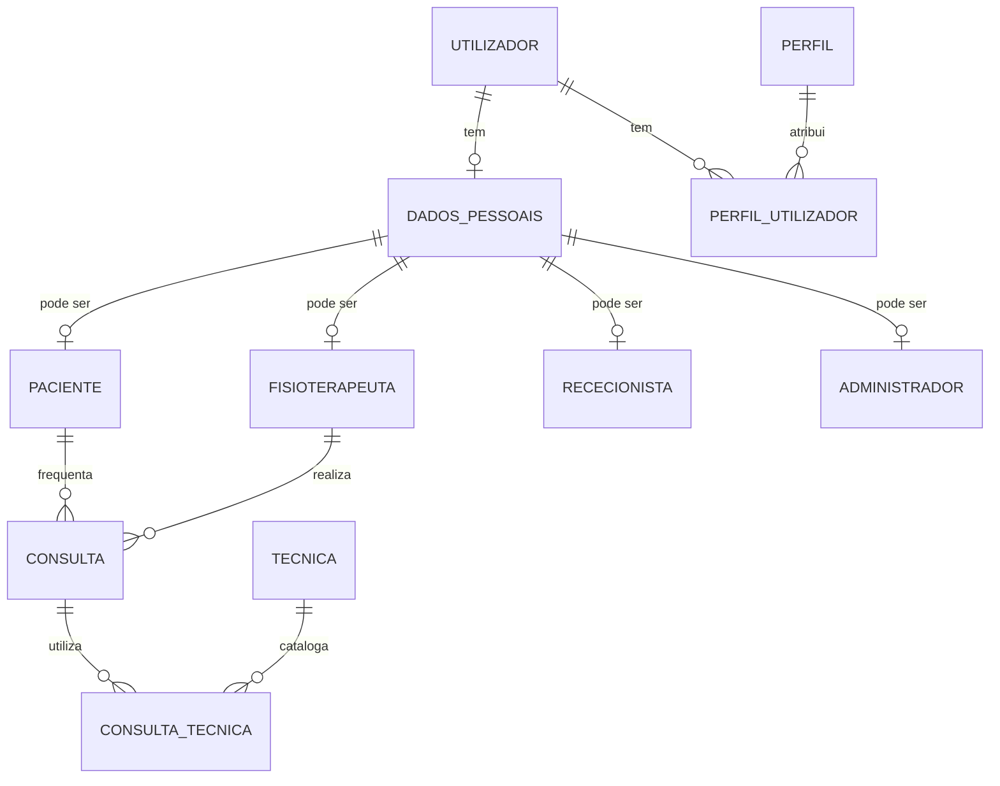

# Modelo de dados

Base de dados **MariaDB 11.8** (`clinica`), acedida pelo Sequelize. São **11 tabelas**: 10 entidades do diagrama, mais a tabela de ligação `perfil_utilizador`. O diagrama original está em .

As tabelas são criadas por `sequelize.sync()` no arranque da vm1 (`RUN_MIGRATIONS=true`, ficheiro `backend/src/db-init.js`), que só cria o que falta e nunca apaga nem altera tabelas existentes. Os dados iniciais vêm de `backend/seeders/seed.js`.

## Diagrama

## Ideia geral

- Uma **conta** (`utilizador`) guarda só o acesso: palavra-passe e estado.
- Os dados da pessoa (nome, email, contacto…) estão em `dados_pessoais`, ligados à conta 1:1.
- O papel clínico da pessoa (paciente, fisioterapeuta, rececionista, administrador) está nas tabelas próprias, cada uma com um `dados_pessoais_id` único.
- As permissões vêm dos **perfis** (`perfil` + `perfil_utilizador`), e vão no token JWT.
- Uma **consulta** liga um paciente a um fisioterapeuta e regista o diagnóstico e a evolução clínica. As **técnicas** usadas ficam em `consulta_tecnica`, com tempo e parâmetros.

## Tabelas

Legenda: **PK** chave primária · **FK** chave estrangeira · **UK** valor único · `null` aceita vazio.

### utilizador
| Campo | Tipo | Notas |
|---|---|---|
| id | int | PK, auto-incremento |
| password_hash | varchar(255) | `null` até a conta ser ativada. Nunca sai nas respostas da API |
| estado | enum | `pendente`, `ativo`, `inativo`. Por defeito `pendente` |
| reset_token_hash | varchar(64) | `null`. Token de ativação ou recuperação (uso único) |
| reset_token_expira | datetime | `null`. Validade do token |

### perfil
| Campo | Tipo | Notas |
|---|---|---|
| id | int | PK |
| tipo_perfil | varchar(30) | UK. `administrador`, `rececionista`, `fisioterapeuta`, `paciente` |

### perfil_utilizador (ligação N:M)
| Campo | Tipo | Notas |
|---|---|---|
| utilizador_id | int | PK, FK → utilizador |
| perfil_id | int | PK, FK → perfil |

### dados_pessoais
| Campo | Tipo | Notas |
|---|---|---|
| id | int | PK |
| utilizador_id | int | FK → utilizador, UK (1:1) |
| nome | varchar(150) | obrigatório, não vazio |
| email | varchar(150) | UK, tem de ser um email válido. É o que se usa para o login |
| contacto | varchar(30) | `null` |
| data_nascimento | date | `null` |
| morada | text | `null` |

### paciente
| Campo | Tipo | Notas |
|---|---|---|
| id | int | PK |
| dados_pessoais_id | int | FK → dados_pessoais, UK |

### fisioterapeuta
| Campo | Tipo | Notas |
|---|---|---|
| id | int | PK |
| dados_pessoais_id | int | FK → dados_pessoais, UK |
| especialidade | varchar(100) | `null` |

### rececionista
| Campo | Tipo | Notas |
|---|---|---|
| id | int | PK |
| dados_pessoais_id | int | FK → dados_pessoais, UK |

### administrador
| Campo | Tipo | Notas |
|---|---|---|
| id | int | PK |
| dados_pessoais_id | int | FK → dados_pessoais, UK |

### consulta
| Campo | Tipo | Notas |
|---|---|---|
| id | int | PK |
| paciente_id | int | FK → paciente, obrigatório |
| fisioterapeuta_id | int | FK → fisioterapeuta, obrigatório |
| data_hora | datetime | obrigatório |
| duracao_minutos | int | obrigatório, por defeito 30 |
| estado | enum | `agendada`, `realizada`, `cancelada`. Por defeito `agendada` |
| diagnostico | text | `null`, preenchido quando a consulta é realizada |
| evolucao_clinica | text | `null`, idem |
| observacoes | text | `null`, idem |

### tecnica
| Campo | Tipo | Notas |
|---|---|---|
| id | int | PK |
| nome | varchar(150) | UK, obrigatório, não vazio |
| categoria | varchar(100) | `null` |
| ativa | boolean | por defeito `true`. Uma técnica inativa não se oferece em consultas novas, mas mantém-se nas antigas |

### consulta_tecnica (ligação N:M com dados extra)
| Campo | Tipo | Notas |
|---|---|---|
| consulta_id | int | PK, FK → consulta |
| tecnica_id | int | PK, FK → tecnica |
| tempo_minutos | int | `null`, mínimo 0 |
| parametros | text | `null`. Exemplo: "80 Hz, intensidade 20 mA" |

## Regras de integridade

- **Histórico clínico protegido:** `paciente` e `fisioterapeuta` não se apagam enquanto tiverem consultas (a base de dados bloqueia e a API responde 409). Da mesma forma, `dados_pessoais` não se apaga enquanto existir paciente, fisioterapeuta, rececionista ou administrador ligado, e `utilizador` não se apaga com `dados_pessoais` associados (`RESTRICT`).
- **Sem duplicados:** o `email` é único, tal como o `tipo_perfil`, o `nome` da técnica e cada `dados_pessoais_id` nas tabelas de papéis.
- **Técnicas:** não se apagam, desativam-se (`ativa = false`).
- **Palavras-passe:** guardadas com bcrypt. O `password_hash` e o `reset_token_hash` nunca são devolvidos pela API.
- **Réplica:** as escritas vão sempre para o primário (vm3). Quando a réplica assíncrona (vm2) estiver ativa, as leituras podem ser servidas por ela e mostrar dados com um pequeno atraso.