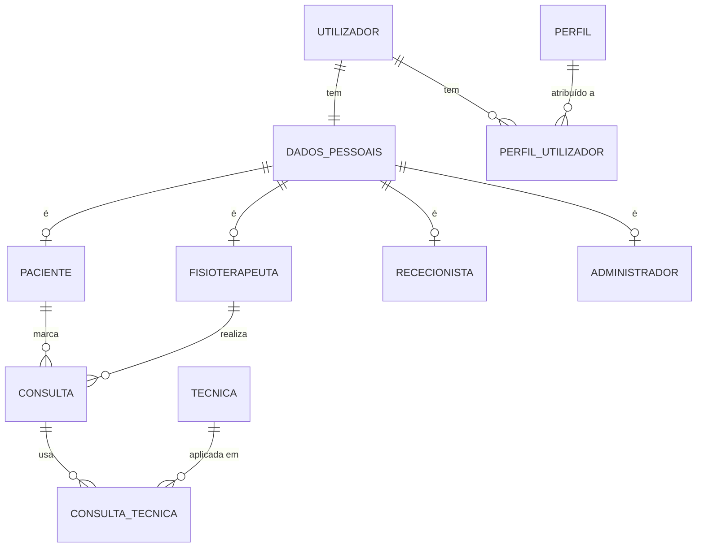

# Modelo de dados

Base de dados MariaDB `clinica` (primário na vm3, réplica na vm2), gerida com Sequelize.

## Diagrama

## Tabelas

| Tabela              | Colunas                                                                                                                                                          | Descrição                                             |
| ------------------- | ---------------------------------------------------------------------------------------------------------------------------------------------------------------- | ----------------------------------------------------- |
| `utilizador`        | id (PK), password_hash, estado (pendente/ativo/inativo), reset_token_hash, reset_token_expira                                                                    | Conta de acesso. A palavra-passe é guardada com hash. |
| `dados_pessoais`    | id (PK), utilizador_id (FK, único), nome, email (único), contacto, data_nascimento, morada                                                                       | Dados comuns a todas as pessoas. O login usa o email. |
| `perfil`            | id (PK), tipo_perfil (único)                                                                                                                                     | Perfis de acesso (RBAC).                              |
| `perfil_utilizador` | utilizador_id (PK, FK), perfil_id (PK, FK)                                                                                                                       | Liga utilizadores a perfis (N:M).                     |
| `paciente`          | id (PK), dados_pessoais_id (FK, único)                                                                                                                           | Papel de paciente.                                    |
| `fisioterapeuta`    | id (PK), dados_pessoais_id (FK, único), especialidade                                                                                                            | Papel de fisioterapeuta.                              |
| `rececionista`      | id (PK), dados_pessoais_id (FK, único)                                                                                                                           | Papel de rececionista.                                |
| `administrador`     | id (PK), dados_pessoais_id (FK, único)                                                                                                                           | Papel de administrador.                               |
| `consulta`          | id (PK), paciente_id (FK), fisioterapeuta_id (FK), data_hora, duracao_minutos, estado (agendada/realizada/cancelada), diagnostico, evolucao_clinica, observacoes | Sessão entre paciente e fisioterapeuta.               |
| `tecnica`           | id (PK), nome (único), categoria, ativa                                                                                                                          | Técnicas de tratamento disponíveis.                   |
| `consulta_tecnica`  | consulta_id (PK, FK), tecnica_id (PK, FK), tempo_minutos, parametros                                                                                             | Técnicas aplicadas em cada consulta (N:M).            |

## Relações

- Um utilizador tem uns dados pessoais (1:1).
- Um utilizador pode ter vários perfis e um perfil pode estar em vários utilizadores (N:M, `perfil_utilizador`).
- Paciente, fisioterapeuta, rececionista e administrador são papéis ligados a `dados_pessoais` (1:1).
- Uma consulta pertence a um paciente e a um fisioterapeuta; um paciente ou fisioterapeuta tem várias consultas (1:N).
- Uma consulta pode usar várias técnicas e uma técnica aparece em várias consultas (N:M, `consulta_tecnica`).
